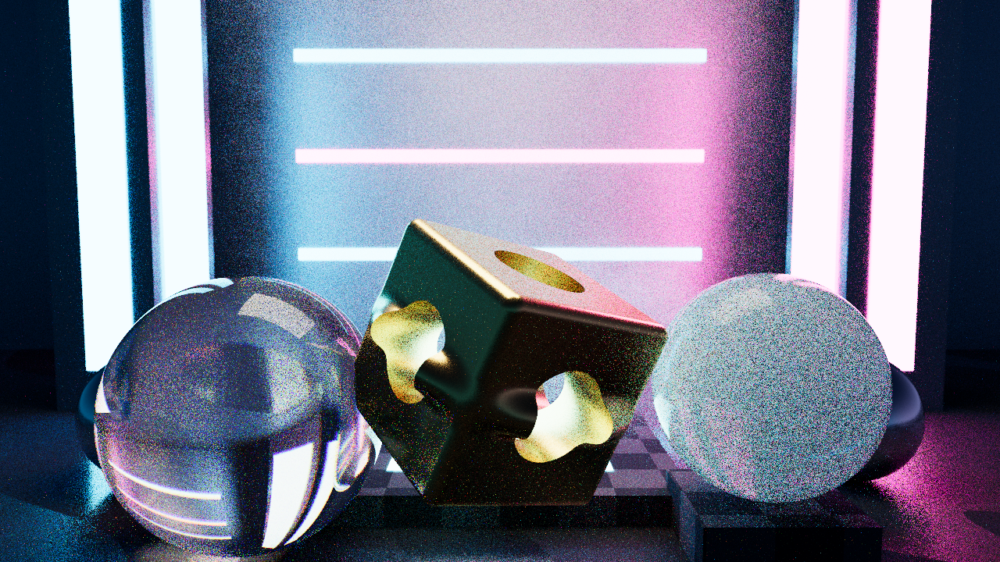

# AetherCoreEngine

**Zero-Dependency Multithreaded 3D Spectral Path Tracer, 3D Incompressible Navier–Stokes Fluid Solver & Procedural 24-Bit Spatial Audio Engine in Pure Rust (`std` only)**



> **Audio Output:** [`renders/simulation_soundtrack.wav`](renders/simulation_soundtrack.wav) (`48,000 Hz`, 24-bit signed stereo PCM, `15.00 s` spatial soundtrack driven directly by the 3D fluid simulation's kinetic energy, vorticity, and plume center-of-mass).

---

## Architectural Highlights

Built from scratch in **Rust** with **zero external crates** (`[dependencies]` is completely empty in [`Cargo.toml`](Cargo.toml)):

### 1. BVH-Accelerated Monte Carlo Hero-Wavelength Spectral Path Tracer
- **3D Linear Algebra & Spectral Radiometry (`src/math.rs`, `src/rng.rs`)**:
  - Complete `Vec3`, `Vec4`, `Mat3`, `Mat4` (exact cofactor/adjugate inversion), Hamilton `Quat` (Rodrigues rotation, `slerp`, matrix conversion), Duff branchless orthonormal basis (`Onb`), and IEEE-754 Kay–Kajiya slab `Aabb`.
  - **4-Wavelength Hero Wavelength Spectral Sampling** (`Wavelengths4`, `Spectrum4`, $380\text{–}750\text{ nm}$), Wyman–Sloan–Shirley CIE 1931 $2^\circ$ standard observer matching functions calibrated to the D65 whitepoint, partition-of-unity smooth spectral reflectance/emission curves (`SpectralCurve`), and Stephen Hill's **ACES Filmic** RRT+ODT tone mapping.
- **SAH BVH & Hybrid Geometry (`src/primitives.rs`, `src/bvh.rs`)**:
  - Supports **Triangles** (Möller–Trumbore + uniform barycentric surface sampling), **Analytic Spheres**, and composable **CSG Signed-Distance Primitives** (`RoundBox`, `Torus`, `Cylinder`, `Sphere`, `Octahedron`, rigid `Transform`, `Union`, `SmoothUnion`, `Intersection`, `Difference`) intersected via Lipschitz-pruned Sphere Tracing with 6-step bisection root polishing and 4-tap tetrahedral central-difference normals.
  - 16-bin **Surface Area Heuristic (SAH)** BVH builder flattened into contiguous depth-first linear nodes (`LinearBvhNode`) with allocation-free front-to-back stack traversal.
- **Physically Based Spectral BSDFs & Next Event Estimation (`src/bsdf.rs`, `src/renderer.rs`)**:
  - **Dielectric**: Exact unpolarized Fresnel equations + Snell refraction + Total Internal Reflection + Cauchy chromatic dispersion ($n(\lambda) = n_0 + B/\lambda^2$) + Beer–Lambert volumetric absorption ($\exp(-\sigma_a(\lambda) d)$).
  - **Conductor**: Exact Born & Wolf complex conductor Fresnel ($\eta(\lambda) + i k(\lambda)$), Trowbridge–Reitz anisotropic **GGX** microfacet distribution, height-correlated **Smith $G_2$** shadowing-masking, and **Heitz (2018) VNDF** importance sampling.
  - **Subsurface Isotropic Volumetric Scattering**: Unbiased Monte Carlo multi-scattering random walk inside translucent solid media (`sigma_s`, `sigma_a`, exponential free-flight sampling, isotropic phase function).
  - **Multiple Importance Sampling (MIS)**: Power heuristic ($\beta = 2$) combining power-weighted area-light Next Event Estimation (`LightEntry` CDF) with BSDF and volumetric phase sampling.
- **Multithreaded Work-Stealing Tile Renderer & Custom PNG Codec (`src/renderer.rs`, `src/png.rs`)**:
  - Center-out spiral `16x16` tile ordering across per-worker `VecDeque<TileJob>` queues with cross-worker **LIFO/FIFO work-stealing** and per-tile nanosecond latency/throughput instrumentation.
  - From-scratch **IEEE 802.3 CRC-32**, **RFC 1950 Adler-32 / zlib**, and **RFC 1951 LZ77 sliding-window + Fixed Huffman DEFLATE** PNG encoder & verifier (plus `.ppm` and `.bmp` codecs).

### 2. 3D Incompressible Navier–Stokes Eulerian Fluid & Vorticity Confinement Solver (`src/fluid.rs`)
- Second-order **MacCormack advection** with local 8-cell trilinear extrema clamping (preventing numerical oscillation and guaranteeing non-negative smoke density $\rho \ge 0$).
- Staggered Marker-and-Cell (MAC) **Helmholtz–Hodge Poisson pressure projection** ($\nabla^2 p = \frac{1}{\Delta t}\nabla\cdot\mathbf{u}^*$) with both **Matrix-Free Conjugate Gradient (CG)** and **Red-Black SOR Gauss–Seidel** solvers.
- **3D Vorticity Confinement** ($\mathbf{f}_{\text{conf}} = \epsilon h (\mathbf{N} \times \boldsymbol{\omega})$) and Boussinesq thermal buoyancy.
- Coupled directly into the spectral path tracer as a **heterogeneous participating medium** (`FluidMedium`) via **Woodcock Delta Tracking**, **Novak Ratio Tracking** volumetric shadow transmittance, and Henyey–Greenstein phase sampling.

### 3. Offline Procedural Synthesizer & 24-Bit WAV Soundtrack Generator (`src/audio.rs`)
- Synthesizes a 15.0-second, `48,000 Hz`, 24-bit stereo soundtrack (`720,000` frames, TPDF-dithered RIFF/WAVE) driven by the fluid solver's time-series telemetry:
  - 16-voice polyphonic **4-Operator DX-style FM Crystalline Bells** with kinetic-energy-modulated harmonic indices.
  - Bandlimited PolyBLEP detuned synth pad & sub-bass sculpted by a cascaded **24 dB/oct 4-Pole Zero-Delay Feedback TPT State-Variable Filter** (Vadim Zavalishin ZDF topology).
  - **8-Line Orthogonal Sylvester–Hadamard Feedback Delay Network (FDN)** cathedral reverb (`hadamard8_normalized` fast Walsh–Hadamard butterfly + $RT_{60}$ two-band absorption + quadrature LFO delay modulation) and binaural Interaural Time Difference (ITD) spatialization.

---

## Verification & Benchmark Results (`1280x720 @ 48 SPP`, 8 Threads)

```text
--------------------------------------------------------------------------------
 AUTOMATED SELF-TEST & INVARIANT VERIFICATION SUITE (6/6 PASSED)
--------------------------------------------------------------------------------
 [PASS] Math / Quat / Mat4^-1 / ONB / Checksums              | max |M*M^-1 - I| = 4.44e-16, ONB ortho = 1.40e-17
 [PASS] SAH BVH Invariants & Ray Equivalence                 | 87 nodes (44 leaves, depth 10), 1785/2500 hits exact (max |dt|=0.00e0)
 [PASS] BSDF & Subsurface Energy Conservation                | Fresnel R+T=1.000000, GGX Furnace peak=0.9926<=1.0, SSS absorb<conserv
 [PASS] 3D Navier-Stokes CG Poisson Projection               | ||div u||_2: 2.5751e0 -> 6.7289e-3 (99.7% reduction)
 [PASS] PNG Binary Header / CRC32 / Adler32 / LZ77 Roundtrip | 1280x720 8-bit RGB, 7 chunks, 2407.2 KB lossless DEFLATE verified
 [PASS] WAV 24-Bit 48kHz Stereo RIFF Header & Spatial Signal | 720000 frames (15.00s), RMS L=0.158 R=0.184, Peak=0.688, StereoDiff=0.166

--------------------------------------------------------------------------------
 WORK-STEALING RENDERER THROUGHPUT & LATENCY PERCENTILE BENCHMARKS
--------------------------------------------------------------------------------
 Total Rays Traced        : 203050212 (44.237M camera samples across 3600 tiles)
 Work-Stealing Scheduler  : 731 cross-worker tile steals across 8 threads
 Aggregate Wall Throughput: 2.089 MRays/sec  |  0.455 MSamples/sec  (Wall: 97.204s)
 Per-Tile Throughput (MRays/sec) :  p50 =   0.358  |  p95 =   0.679  |  p99 =   0.786
 Per-Tile Latency    (millisec)  :  p50 = 157.467  |  p95 = 573.245  |  p99 = 1090.189
```

## Quick Start

```bash
# Run full unit & integration test suite (16 tests)
cargo test --release

# Run full production pipeline (fluid solver -> path tracer -> audio synthesizer -> verification)
cargo run --release

# Custom resolution / sample count override
cargo run --release -- --width 1280 --height 720 --spp 48 --fluid-steps 120
```
